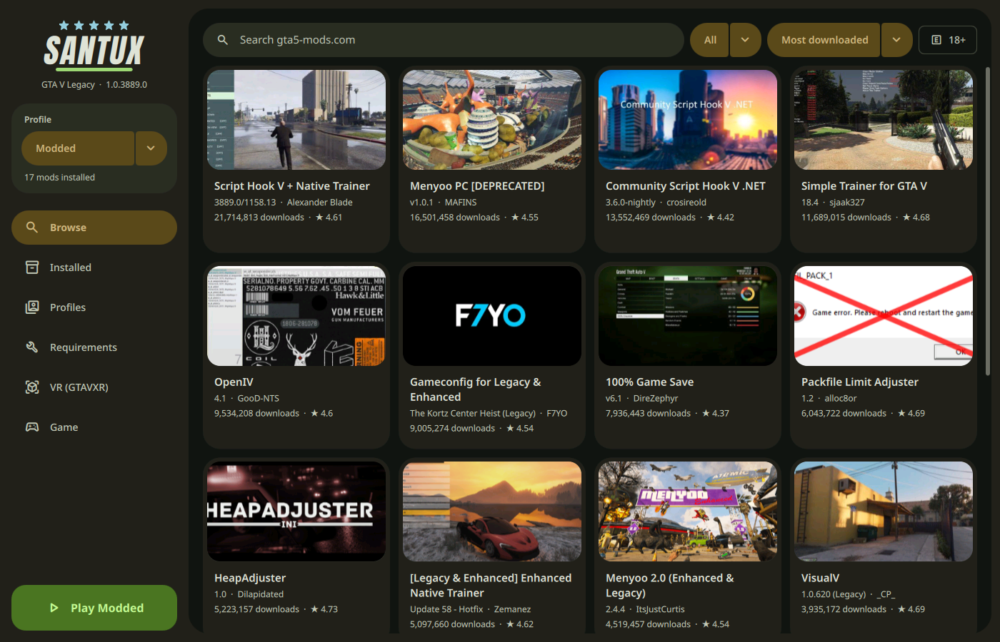

<p align="center">
  <picture>
    <source media="(prefers-color-scheme: dark)" srcset="assets/banner-dark.png">
    
  </picture>
</p>

<p align="center">A GTA V mod manager for Linux (Steam + Proton).</p>



- **Browse and install** mods from [gta5-mods.com](https://www.gta5-mods.com), with a preview of
  what each archive will install. Downloads are checked against the site's SHA-256.
- **Native .oiv support**, no OpenIV or Wine needed. Original game files are never modified.
- **Mod profiles** you can switch between instantly, plus built-in **Vanilla** and **GTAVXR** (VR).
- **Launch from Steam** with a small profile picker, or straight into a chosen profile.
- **One-click requirements:** Script Hook V, ScriptHookVDotNet, a mods folder loader, .NET 4.8 and
  VC++ in the prefix, a gameconfig and the usual stability patches.

GTA V Legacy is fully supported; Enhanced partly (ScriptHookVDotNet, the gameconfig and GTAVXR are
Legacy-only). Story mode only.

## Install

You need Steam with GTA V installed and launched once, plus `7z` and
[protontricks](https://github.com/Matoking/protontricks) (`sudo pacman -S 7zip protontricks` on Arch).

```sh
./build.sh      # builds dist/santux, a single self-contained binary
./install.sh    # installs it to ~/.local/bin and adds Santux to your app menu
```

`build.sh` needs Python 3.10+ and fetches its build tools into `.venv` on first run.

## Getting started

1. Close GTA V and Steam.
2. **Requirements → Install all missing** (the .NET install takes 10–20 minutes).
3. **Profiles → Steam launch option → Set.** It sets GTA V's launch option to
   `santux launch %command%`.
4. Find mods on **Browse** and install them.

Starting GTA V from Steam then shows the profile picker. Use `--profile NAME`, `--vanilla` or `--vr`
in the launch option to skip it, or `santux play NAME` to start a profile from a script or shortcut.

The interface takes its colours from [KiiteShell](https://github.com/Kiite-Org/KiiteShell) or
[caelestia](https://github.com/caelestia-dots/cli) when available, and otherwise from the
[GTA V palette](https://www.schemecolor.com/grand-theft-auto-gta-v.php).

## Command line

```sh
santux launch [--profile NAME | --vanilla | --vr | --ask] %command%
santux play NAME
santux profiles [--use S] [--new NAME] [--delete S] [--launch-default S|ask]
santux search QUERY [--sort most-liked]
santux install <gta5-mods URL | archive | folder> [--dry-run]
santux reqs | req ID | list | uninstall ID
```

## Credits

- **Tux** by Larry Ewing, made with The GIMP (recoloured monochrome version).
- **Material Symbols Rounded** by Google, Apache 2.0, bundled for icons.
- **Anton** by The Anton Project Authors, SIL Open Font License 1.1, bundled for the banner.
